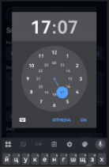

# Protocall — Bug Reports

Bug reports submitted to the **Protocall Bug Bounty Program** (messenger [protocall.ch](https://protocall.ch/), Contributors Space → Bug Bounty Program, tags: `bug`, `low`).

| # | Title | Date | Platform |
|---|-------|------|----------|
| 1 | [No permission prompt when tapping camera icon with denied camera access](#bug-1-no-permission-prompt-when-tapping-camera-icon-with-denied-camera-access) | Aug 4 | Android |
| 2 | [App freezes indefinitely when saving a room with an extremely long name (300+ characters), requires force close](#bug-2-app-freezes-indefinitely-when-saving-a-room-with-an-extremely-long-name-300-characters-requires-force-close) | Aug 5 | Android |
| 3 | [Tapping on the time field re-opens the date calendar instead of the time picker when editing a scheduled room](#bug-3-tapping-on-the-time-field-re-opens-the-date-calendar-instead-of-the-time-picker-when-editing-a-scheduled-room) | — | Android |
| 4 | [No download link on invite landing page for non-installed users](#bug-4-no-download-link-on-invite-landing-page-for-non-installed-users) | Aug 5 | Android |

---

## Bug 1: No permission prompt when tapping camera icon with denied camera access

### Title
No permission prompt when tapping camera icon with denied camera access

### Description
Camera permission is not requested when adding profile photo — process silently cancels if permission was previously denied.

### Steps to Reproduce
1. Deny camera access permission for the app in device settings
2. Open the app
3. Tap on "Profile"
4. Tap on "Personal Profile"
5. Tap on the camera icon on the avatar placeholder
6. Select the "Photos" option from the menu that appears

### Expected result
The app should trigger a system permission request dialog asking the user to grant camera access (or, at minimum, show an informative message explaining that camera access is required and guiding the user to enable it in device settings).

### Actual result
The screen closes immediately and the user is returned to the profile/screen, no permission prompt appears, no explanation is given.

### Environment

| Field | Value |
|-------|-------|
| Platform | Android |
| Device model | Huawei Mate 20 Pro |
| OS version | Android 10, EMUI 12.0.0 |
| Browser | None |
| App version | 2.1 |

### Media

Original forum post: [full](images/bug-01-forum-post.png) · [zoomed](images/bug-01-forum-post-zoom.png)

---

## Bug 2: App freezes indefinitely when saving a room with an extremely long name (300+ characters), requires force close

### Title
App freezes indefinitely when saving a room with an extremely long name (300+ characters), requires force close

### Description
When attempting to create a room with an extremely long name (300+ characters), the app displays a loading spinner indefinitely and becomes completely unresponsive — no error message, no timeout, no way to cancel the action. The only way to recover is to force-close and reopen the app.

### Steps to Reproduce
1. Open the app
2. Tap "Rooms" → "Create Room"
3. In the room name field, enter a name with 300+ characters
4. Complete the rest of the scheduling flow (date, time) in case scheduling
5. Tap "Schedule a room" or "Start room"

### Expected result
Either the app should enforce a reasonable character limit on the room name field (preventing input beyond a certain length), or, if long names are allowed, the save action should complete successfully or show a clear validation error.

### Actual result
The app displays a loading spinner indefinitely and becomes completely unresponsive: no error message, no timeout, no way to cancel the action. The only way to recover is to force-close and reopen the app.

### Environment

| Field | Value |
|-------|-------|
| Platform | Android |
| Device model | Huawei Mate 20 Pro |
| OS version | Android 10, EMUI 12.0.0 |
| Browser | None |
| App version | 2.1 |

### Media

Original forum post: [full](images/bug-02-forum-post.png)

---

## Bug 3: Tapping on the time field re-opens the date calendar instead of the time picker when editing a scheduled room

### Title
Tapping on the time field re-opens the date calendar instead of the time picker when editing a scheduled room

### Description
Tapping the time field re-opens the date calendar first, the user has to re-confirm the date (even though they didn't intend to change it) before being able to access the time picker again.

### Steps to Reproduce
1. Open the app
2. Tap on "Rooms" icon
3. Tap "Create Room"
4. Tap "Schedule for later"
5. Select a date in the calendar, tap "OK"
6. Select a time on the clock screen, tap "OK"
7. On the "Schedule New Room" screen, tap directly on the time field to edit it

### Expected result
Tapping the time field should open the time picker directly, allowing the user to change only the time without re-confirming the date.

### Actual result
Tapping the time field re-opens the date calendar first, the user has to re-confirm the date (even though they didn't intend to change it) before being able to access the time picker again.

### Frequency
Always

### Environment

| Field | Value |
|-------|-------|
| Platform | Android |
| Device model | Huawei Mate 20 Pro |
| OS version | Android 10, EMUI 12.0.0 |
| Browser | None |
| App version | 2.1 |

### Media

---

## Bug 4: No download link on invite landing page for non-installed users

### Title
No download link on invite landing page for non-installed users

### Description
Invite link landing page (for users without the app installed) lacks a clear call-to-action or download link.

### Steps to Reproduce
1. Create a scheduled room and generate an invite link
2. Open the invite link on a device where Protocall is not installed
3. Observe the landing page shown in the browser

### Expected result
The landing page shows a clear call-to-action with a link to download the app, so the invited user can install Protocall and join the room.

### Actual result
The landing page has no download link and no clear call-to-action, so the invited user has no obvious way to get the app and join the room.

### Frequency
Always

### Environment

| Field | Value |
|-------|-------|
| Platform | Android |
| Device model | Huawei Mate 20 Pro |
| OS version | Android 10, EMUI 12.0.0 |
| Browser | Chrome |
| App version | 2.1 |
